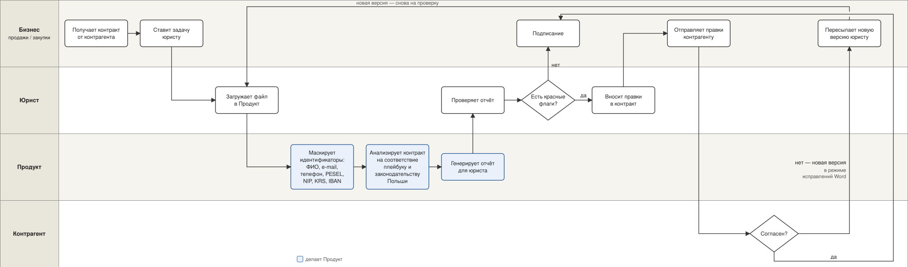
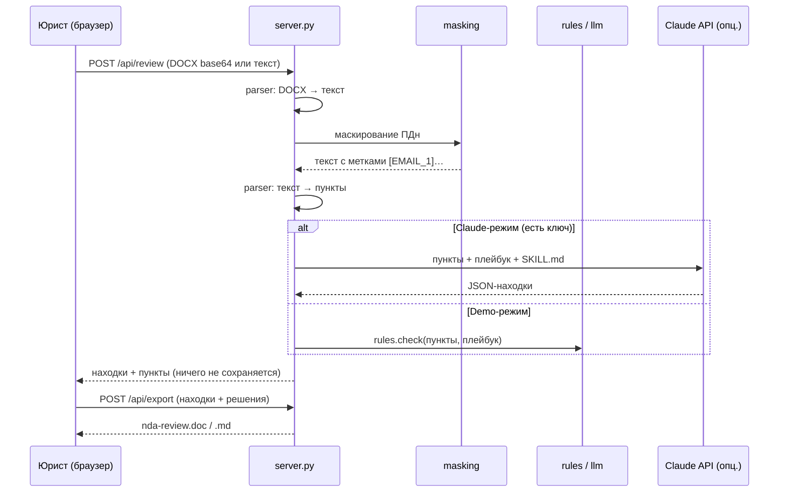

# Архитектура и процесс

## 1. Бизнес-процесс: как сейчас (AS-IS)

Исходник схемы: [`diagrams/as-is.svg`](diagrams/as-is.svg). Каждой роли — своя горизонтальная полоса, шаг роли нарисован в её полосе.

| Роль | Что делает |
|------|-----------|
| Бизнес (продажи / закупки) | Получает контракт, пишет юристу, отправляет правки контрагенту, пересылает юристу новую версию, подписывает |
| Юрист | Ждёт в очереди, читает весь текст и сверяет с плейбуком по памяти, правит в Word |
| Контрагент | Принимает правки или присылает новую версию в режиме исправлений Word |

Узкие места:
- **Очередь к юристу — около 2 дней на каждый раунд правок.** Новая версия от контрагента приходит через бизнес и снова встаёт в очередь.
- **Ручная сверка с плейбуком по памяти** — на каждой версии юрист заново читает весь текст.

Изменения контрагента видны в режиме исправлений Word, поэтому ручного поиска изменений между версиями в процессе нет.

## 2. Бизнес-процесс: с Продуктом (TO-BE)

Исходник схемы: [`diagrams/to-be.svg`](diagrams/to-be.svg). Устроена так же, как AS-IS: каждой роли — своя горизонтальная полоса.

| Роль | Что делает |
|------|-----------|
| Бизнес (продажи / закупки) | Получает контракт, ставит задачу юристу, отправляет правки контрагенту, пересылает юристу новую версию, подписывает |
| Юрист | Загружает файл в Продукт, проверяет отчёт; если есть красные флаги — вносит правки в контракт, если нет — контракт идёт на подписание |
| Продукт | Маскирует идентификаторы, анализирует контракт на соответствие плейбуку и законодательству Польши, генерирует отчёт для юриста |
| Контрагент | Принимает правки или присылает новую версию в режиме исправлений Word |

Что меняется по сравнению с AS-IS:

| Шаг | AS-IS | TO-BE |
|-----|-------|-------|
| Вход контракта | Письмо юристу → очередь ~2 дня на каждый раунд | Бизнес ставит задачу юристу, юрист сразу загружает файл в Продукт |
| Сверка с плейбуком | Юрист читает весь текст и сверяет по памяти | Продукт анализирует контракт и генерирует отчёт, **юрист проверяет отчёт** |
| Персональные данные | — | Продукт маскирует ФИО, e-mail, телефон, PESEL, NIP, KRS, IBAN |
| Решение по контракту | Юрист правит в Word по памяти, бизнес отправляет правки контрагенту | Нет красных флагов — сразу на подписание. Есть — юрист вносит правки в контракт, бизнес отправляет их контрагенту |
| Новая версия | Бизнес пересылает, снова очередь, юрист заново сверяет весь текст | Бизнес пересылает, юрист загружает новую версию в Продукт на проверку |

Сценарий:
1. Бизнес получает контракт от контрагента и ставит задачу юристу.
2. Юрист загружает файл в Продукт.
3. Продукт маскирует идентификаторы, анализирует контракт на соответствие плейбуку и законодательству Польши и генерирует отчёт.
4. Юрист проверяет отчёт: есть ли красные флаги?
   - **Нет** → контракт идёт на подписание.
   - **Да** → юрист вносит правки в контракт, бизнес отправляет правки контрагенту.
5. Контрагент согласен → подписание. Не согласен → присылает новую версию в режиме исправлений Word, бизнес пересылает её юристу, процесс повторяется с шага 2.

Решение на каждом шаге принимает юрист (human-in-the-loop): Продукт готовит отчёт, юрист проверяет его и решает, править ли контракт.

Расхождения TO-BE с прототипом v0.1:
- Маскирование ФИО не реализовано (FR-004 ⬜).
- Анализ на соответствие **законодательству Польши** не реализован и не входит в спецификацию: v0.1 проверяет только по плейбуку (F3).
- Сравнение версий — отдельный экран без карточек правок; сравнение рисков между версиями всегда работает на правилах (`compare.py` → `rules.check`), даже в Claude-режиме.

## 3. Компоненты v0.1

| Компонент | Файл | Технология | Что делает |
|-----------|------|------------|-----------|
| Frontend | `app/static/` | HTML + CSS + JS без фреймворков | 3 экрана: Review, Compare, Playbook |
| Backend | `app/server.py` | Python 3.9+ стандартная библиотека (`http.server`) | REST API, без внешних пакетов |
| Парсер | `app/engine/parser.py` | `zipfile` + XML | DOCX/TXT → пункты |
| Маскирование | `app/engine/masking.py` | регулярные выражения | e-mail, телефон, PESEL, NIP, KRS, IBAN → метки |
| Проверка (demo) | `app/engine/rules.py` | правила на регулярных выражениях | 10 правил NDA, детерминированно |
| Проверка (AI) | `app/engine/llm.py` | Claude API (`anthropic` SDK), structured output | Тот же плейбук, инструкции из `skills/nda-review/SKILL.md` |
| Сравнение | `app/engine/compare.py` | `difflib` | Diff по пунктам + изменения рисков |
| Отчёт | `app/engine/report.py` | HTML для Word, Markdown | Экспорт с решениями юриста |
| Плейбук | `app/playbooks/nda_pl.json` | JSON | Правила компании |
| Хранилище | — | — | v0.1 ничего не хранит |

Решение о стеке: [ADR-0004](decisions/0004-prototype-stack.md).

## 4. Поток данных

## 5. API

| Метод | Путь | Вход | Выход |
|-------|------|------|-------|
| GET | `/api/status` | — | доступен ли Claude-режим, модель |
| GET | `/api/playbook` | — | плейбук JSON |
| GET | `/api/samples` | — | обезличенные образцы NDA |
| POST | `/api/review` | `text` или `file_b64` + `filename` | пункты, находки, счётчики, что замаскировано |
| POST | `/api/compare` | `old_text`, `new_text` | изменения по пунктам, изменения рисков |
| POST | `/api/export` | `review`, `decisions`, `format` (doc/md) | файл отчёта |

## Связанные решения
- [ADR-0003](decisions/0003-mvp-contract-type-nda.md) — тип договора NDA
- [ADR-0004](decisions/0004-prototype-stack.md) — стек прототипа
