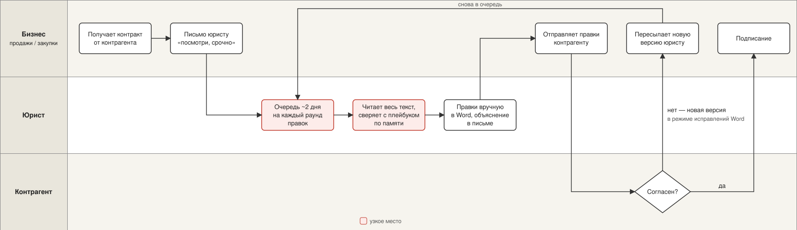
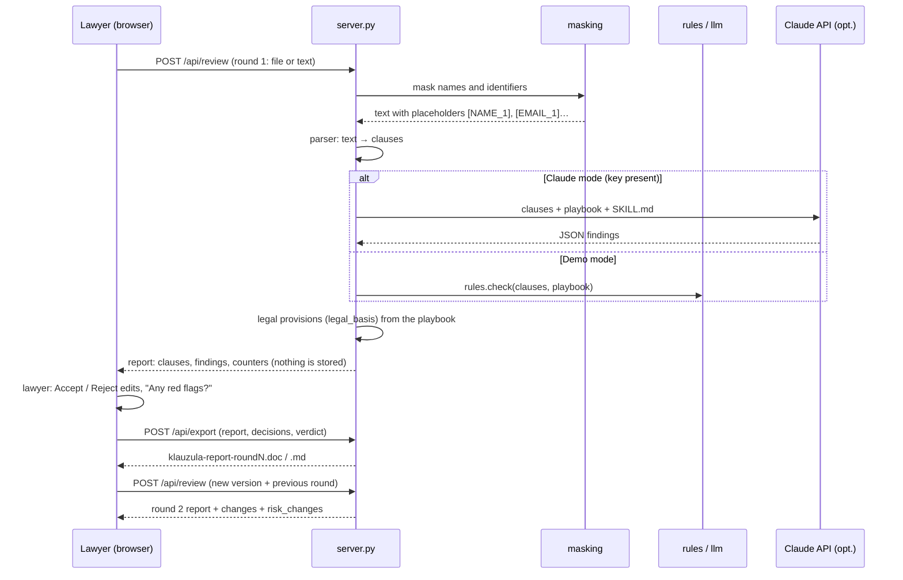

# Architecture and process

## 1. Business process: as is today (AS-IS)

Diagram source: [`diagrams/as-is.svg`](diagrams/as-is.svg). Each role has its own horizontal lane; a role's step is drawn in its lane.

| Role | What it does |
|------|--------------|
| Business (sales / procurement) | Receives the contract, writes to the lawyer, sends edits to the counterparty, forwards the new version to the lawyer, signs |
| Lawyer | Waits in a queue, reads the whole text and checks it against the playbook from memory, edits in Word |
| Counterparty | Accepts the edits or sends a new version with Word track changes |

Bottlenecks:
- **Queue to the lawyer — about 2 days per round of edits.** The counterparty's new version arrives through the business and joins the queue again.
- **Manual playbook check from memory** — on every version the lawyer re-reads the whole text.

The counterparty's changes are visible in Word track changes, so there is no manual search for changes between versions in the process.

## 2. Business process: with the Product (TO-BE)

Diagram source: [`diagrams/to-be.svg`](diagrams/to-be.svg). Built like AS-IS: each role has its own horizontal lane.

| Role | What it does |
|------|--------------|
| Business (sales / procurement) | Receives the contract, assigns a task to the lawyer, sends edits to the counterparty, forwards the new version to the lawyer, signs |
| Lawyer | Uploads the file to the Product, reviews the report; if there are red flags — edits the contract, if not — the contract goes to signing |
| Product | Masks identifiers, analyses the contract against the playbook and Polish legislation, generates a report for the lawyer |
| Counterparty | Accepts the edits or sends a new version with Word track changes |

What changes compared with AS-IS:

| Step | AS-IS | TO-BE |
|------|-------|-------|
| Contract intake | E-mail to the lawyer → queue ~2 days per round | The business assigns a task to the lawyer, the lawyer uploads the file to the Product straight away |
| Playbook check | The lawyer reads the whole text and checks from memory | The Product analyses the contract and generates a report, **the lawyer reviews the report** |
| Personal data | — | The Product masks names, e-mail, phone, PESEL, NIP, KRS, IBAN |
| Decision on the contract | The lawyer edits in Word from memory, the business sends the edits to the counterparty | No red flags — straight to signing. Red flags — the lawyer edits the contract, the business sends the edits to the counterparty |
| New version | The business forwards it, queue again, the lawyer re-checks the whole text | The business forwards it, the lawyer uploads the new version to the Product for review |

Scenario:
1. The business receives the contract from the counterparty and assigns a task to the lawyer.
2. The lawyer uploads the file to the Product.
3. The Product masks identifiers, analyses the contract against the playbook and Polish legislation and generates a report.
4. The lawyer reviews the report: are there red flags?
   - **No** → the contract goes to signing.
   - **Yes** → the lawyer edits the contract, the business sends the edits to the counterparty.
5. The counterparty agrees → signing. Disagrees → sends a new version with Word track changes, the business forwards it to the lawyer, and the process repeats from step 2.

The lawyer makes the decision at every step (human-in-the-loop): the Product prepares the report, the lawyer reviews it and decides whether to edit the contract.

How the TO-BE steps are implemented in prototype v0.2 ([ADR-0007](decisions/0007-scope-v0-2-to-be-process.md)):

| TO-BE step | Feature | v0.2 screen | Limitation |
|------------|---------|-------------|------------|
| The lawyer uploads the file to the Product | F1 | Review → Upload (round 1) | — |
| Masks identifiers, including names | F2 | Summary "Masked before analysis" | Names — by marker words, in the signature block and next to job titles; repeats, initials and grammatical cases get the same placeholder; a name outside these places is not found |
| Analyses against the playbook and Polish legislation | F3 | Finding cards with a "Polish law · to verify" block | A reference to a provision behind a playbook rule, not an analysis of mandatory norms; provisions not verified by a lawyer |
| Generates report → the lawyer reviews the report | F4 | Contract sheet + cards, report export | Track changes in .docx — no |
| Any red flags? | F4 | "Your decision" block: "ready for signing" / "send edits" | The Product only counts flags, the lawyer decides |
| New version — back to review | F5 | "Upload new version" → Round 2 with a "Since round 1" block | Track changes from .docx are read as accepted |

Closed v0.1 divergences: name masking (partly), Polish legal provisions, the lawyer's decision step; the separate Compare tab was removed — comparison became part of the round and uses the findings of the same mode (rules or Claude).

## 3. v0.2 components

| Component | File | Technology | What it does |
|-----------|------|------------|--------------|
| Frontend | `app/static/` | HTML + CSS + JS, no frameworks | 2 tabs: Review contract (rounds, lawyer's decision), Playbook |
| Backend | `app/server.py` | Python 3.9+ standard library (`http.server`) | REST API, no external packages |
| Parser | `app/engine/parser.py` | `zipfile` + XML | DOCX/TXT → clauses |
| Masking | `app/engine/masking.py` | regular expressions | Names (markers, signature block, job titles; one placeholder per person), e-mail, phone, PESEL, NIP, KRS, IBAN → placeholders |
| Review (demo) | `app/engine/rules.py` | regular-expression rules | 10 NDA rules, deterministic |
| Review (AI) | `app/engine/llm.py` | Claude API (`anthropic` SDK), structured output | The same playbook, instructions from `skills/nda-review/SKILL.md` |
| Legal provisions | `app/engine/__init__.py` | — | Adds `legal_basis` from the playbook to each finding (not from the model's answer) |
| Rounds | `app/engine/compare.py` | `difflib` | Clause-level diff + risk changes between the findings of the previous and the new round |
| Report | `app/engine/report.py` | HTML for Word, Markdown | Lawyer's decision, changes since the previous round, edits for the business, legal provisions |
| Playbook | `app/playbooks/nda_pl.json` 0.2.0 | JSON | Company rules + `legal_basis` |
| Storage | — | — | v0.2 stores nothing: the previous round lives in the browser and is passed in the request |

Decision on the stack: [ADR-0004](decisions/0004-prototype-stack.md).

## 4. Data flow (v0.2)

## 5. API

| Method | Path | Input | Output |
|--------|------|-------|--------|
| GET | `/api/status` | — | whether Claude mode is available, model |
| GET | `/api/playbook` | — | playbook JSON with `legal_basis` |
| GET | `/api/samples` | — | anonymised NDA samples |
| POST | `/api/review` | `text` or `file_b64` + `filename`; optionally `previous` = `{round, clauses, findings}` | `round`, clauses, findings with `legal_basis`, counters, `red_flags`, what was masked; with `previous` — `changes`, `risk_changes` |
| POST | `/api/export` | `review`, `decisions`, `verdict` (`sign` / `edits`), `format` (doc/md) | report file |

`/api/compare` was removed in v0.2: comparison is part of `/api/review` with `previous`.

## Related decisions
- [ADR-0003](decisions/0003-mvp-contract-type-nda.md) — contract type NDA
- [ADR-0004](decisions/0004-prototype-stack.md) — prototype stack
- [ADR-0007](decisions/0007-scope-v0-2-to-be-process.md) — v0.2 scope per the TO-BE process
