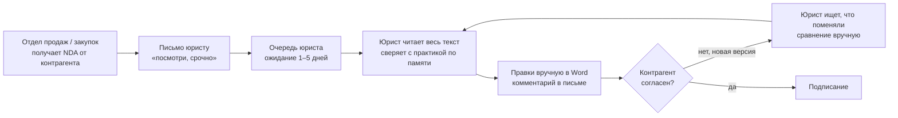
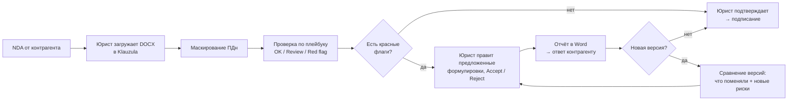
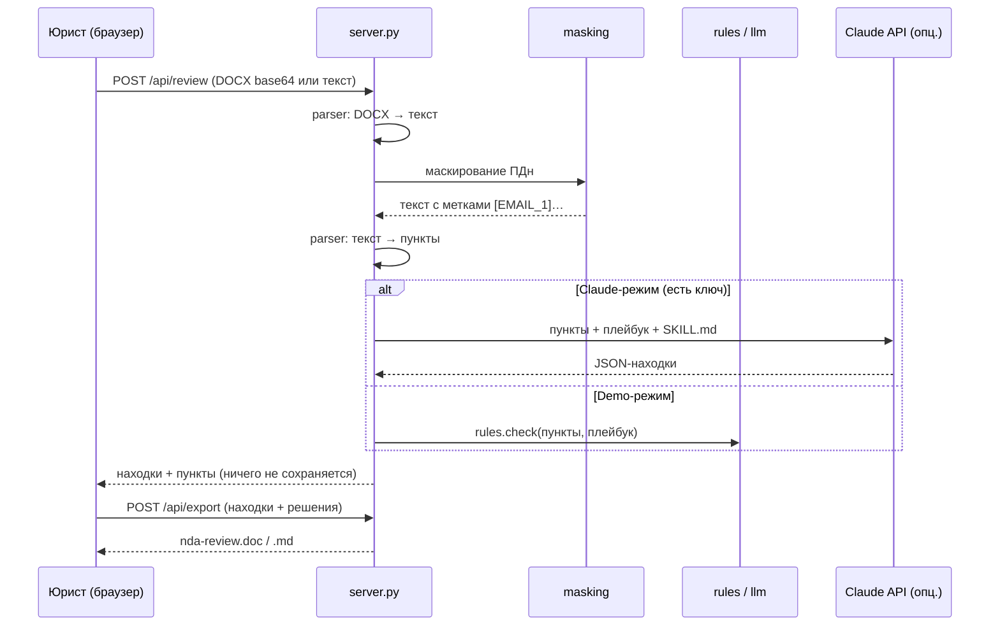

# Архитектура и процесс

## 1. Бизнес-процесс: как сейчас (AS-IS)

Узкие места: очередь к юристу, ручная сверка с правилами, ручное сравнение версий.

## 2. Бизнес-процесс: с Klauzula (TO-BE)

Решение на каждом шаге принимает юрист (human-in-the-loop). Klauzula убирает ручную сверку и ручное сравнение.

## 3. Компоненты v0.1

| Компонент | Файл | Технология | Что делает |
|-----------|------|------------|-----------|
| Frontend | `app/static/` | HTML + CSS + JS без фреймворков | 3 экрана: Review, Compare, Playbook |
| Backend | `app/server.py` | Python 3.9+ стандартная библиотека (`http.server`) | REST API, без внешних пакетов |
| Парсер | `app/engine/parser.py` | `zipfile` + XML | DOCX/TXT → пункты |
| Маскирование | `app/engine/masking.py` | регулярные выражения | e-mail, телефон, PESEL, NIP, KRS, IBAN → метки |
| Проверка (demo) | `app/engine/rules.py` | правила на регулярных выражениях | 10 правил NDA, детерминированно |
| Проверка (AI) | `app/engine/llm.py` | Claude API (`anthropic` SDK), structured output | Тот же плейбук, инструкции из `skills/nda-review/SKILL.md` |
| Сравнение | `app/engine/compare.py` | `difflib` | Diff по пунктам + изменения рисков |
| Отчёт | `app/engine/report.py` | HTML для Word, Markdown | Экспорт с решениями юриста |
| Плейбук | `app/playbooks/nda_pl.json` | JSON | Правила компании |
| Хранилище | — | — | v0.1 ничего не хранит |

Решение о стеке: [ADR-0004](decisions/0004-prototype-stack.md).

## 4. Поток данных

## 5. API

| Метод | Путь | Вход | Выход |
|-------|------|------|-------|
| GET | `/api/status` | — | доступен ли Claude-режим, модель |
| GET | `/api/playbook` | — | плейбук JSON |
| GET | `/api/samples` | — | обезличенные образцы NDA |
| POST | `/api/review` | `text` или `file_b64` + `filename` | пункты, находки, счётчики, что замаскировано |
| POST | `/api/compare` | `old_text`, `new_text` | изменения по пунктам, изменения рисков |
| POST | `/api/export` | `review`, `decisions`, `format` (doc/md) | файл отчёта |

## Связанные решения
- [ADR-0003](decisions/0003-mvp-contract-type-nda.md) — тип договора NDA
- [ADR-0004](decisions/0004-prototype-stack.md) — стек прототипа
